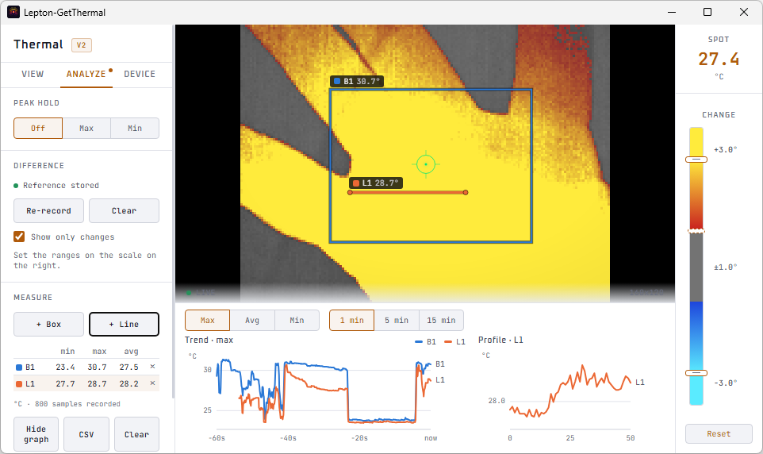

# Lepton-GetThermal

> **Android:** see [README-android.md](README-android.md).

> **Warning:** This entire application was coded by AI agents (Claude Code). Review the code accordingly before using it in any critical context.



A thermal camera viewer for the FLIR Lepton module via PureThermal USB adapter, for **macOS, Windows and Linux**. Built with Tauri v2, Rust, and React.

Lepton-GetThermal streams raw **Y16 radiometric data** straight from the USB device instead of the pre-processed BGRA webcam image. On macOS it uses IOKit isochronous USB (AVFoundation only exposes BGRA); on Windows and Linux it uses libusb. This preserves the full 16-bit thermal values needed for accurate temperature measurement and custom processing.

Windows and Linux setup (WinUSB driver, udev rule, portable build) is described in [README-cross-platform.md](README-cross-platform.md).

## Features

- **Raw Y16 streaming** — Direct USB isochronous transfers from PureThermal (160×120 @ 9 fps): IOKit on macOS, libusb on Windows/Linux
- **Color palettes** — Iron Black (FLIR-style), Rainbow, Grayscale
- **Polarity** — White-hot / Black-hot toggle
- **Isotherm overlay** — Configurable temperature threshold with striped visual overlay
- **Neural network upscaling** — ESPCN 3× super-resolution via embedded ONNX model (160×120 → 480×360)
- **Radiometry** — Spot temperature readout in °C/°F with interactive spotmeter ROI
- **Min/Max markers** — Visual pins showing hottest and coldest pixel locations
- **Flat-field correction** — Trigger shutter recalibration
- **Screenshot capture** — Save frames as PNG
- **Box and line measurements** — min / max / avg per box or line, live trend graph (1 / 5 / 15 min) and line profile, CSV export
- **Temperature under the pointer** — Hover readout from the raw frame
- **Peak hold** — Per-pixel max or min since start or reset
- **Difference mode** — Record a reference and show only pixels that warmed or cooled
- **Adjustable range** — Drag handles on the color scale; equalized (histogram) contrast option
- **Rotation** — 0° / 90° / 180° / 270°, applied to overlays and captures too
- **Auto-connect** — Connects as soon as the camera is plugged in, with a status screen until then
- **Session file** — All settings, boxes and lines are restored at the next start
- **Themes** — Auto / Light / Dark
- **Measurement settings** — Gain (high / low / auto), emissivity with material presets, reflected temperature

See [README-cross-platform.md](README-cross-platform.md#viewer-features-added-in-this-fork) for details.

This fork also fixes Lepton attribute sizes that made several camera settings (and radiometry
detection) silently fail on every platform, including macOS. See
[Fixes that also affect macOS](README-cross-platform.md#fixes-that-also-affect-macos).

## Prerequisites

- **macOS 13+** (Apple Silicon or Intel), **Windows 10/11 x64** (WinUSB driver via Zadig), or **Linux** (udev rule)
- **Node.js** (v18+)
- **Rust** (stable toolchain)
- **FLIR Lepton** module with **PureThermal** USB adapter (VID `1e4e`, PID `0100`)

## Getting started

```bash
# Install frontend dependencies
npm install

# Run in development mode
npm run tauri dev

# Build for production
npm run tauri build
```

The macOS production build outputs:
- `src-tauri/target/release/bundle/macos/Lepton-GetThermal.app`
- `src-tauri/target/release/bundle/dmg/Lepton-GetThermal_<version>_aarch64.dmg`

On Windows, build the portable zip (exe + DLLs, nothing to install) with:

```powershell
powershell -ExecutionPolicy Bypass -File scripts\build-windows.ps1
# -> src-tauri\target\release\portable\Lepton-GetThermal_<version>_x64-portable.zip
```

## Architecture

```
┌─────────────────────────────────────────────────────────┐
│  React Frontend                                         │
│  ┌──────────┐  ┌──────────┐  ┌───────────────────────┐  │
│  │ Control  │  │  Video   │  │ Overlays (markers,    │  │
│  │  Panel   │  │  Canvas  │  │ spotmeter, isotherm)  │  │
│  └────┬─────┘  └────▲─────┘  └───────────────────────┘  │
│       │  Tauri       │ base64 RGBA                       │
│       │  invoke()    │ "thermal-frame" event              │
├───────┼──────────────┼───────────────────────────────────┤
│  Rust Backend        │                                   │
│       │         ┌────┴──────────────┐                    │
│       ▼         │ Processing Pipeline│                   │
│  ┌─────────┐    │  Y16 → auto-gain  │                   │
│  │ Lepton  │    │  → [invert]       │                   │
│  │   SDK   │    │  → [upscale ONNX] │                   │
│  │  (UVC)  │    │  → colorize (LUT) │                   │
│  └────┬────┘    │  → [isotherm]     │                   │
│       │         │  → RGBA           │                   │
│       │         └────▲──────────────┘                    │
│       │              │ raw Y16 frames                    │
│       │         ┌────┴────────────┐                      │
│       └────────►│  IOKit USB      │                      │
│                 │  (isochronous)  │                      │
│                 └────────┬────────┘                      │
└──────────────────────────┼───────────────────────────────┘
                           │
                    PureThermal USB
                     FLIR Lepton
```

### Processing pipeline

Each frame follows this path:

1. **Peak hold** *(optional)* — Replace the live frame with each pixel's held max or min
2. **Auto-gain** — Normalize 16-bit Y16 to 8-bit grayscale (linear stretch, fixed range, or plateau histogram equalization)
3. **Invert** — Flip grayscale if polarity is black-hot
4. **Upscale** *(optional)* — ESPCN 3× neural network super-resolution
5. **Colorize** — Apply 256-entry RGB palette LUT
6. **Difference** *(optional)* — Color only pixels outside the recorded per-pixel reference range
7. **Isotherm** *(optional)* — Overlay red/white stripes on pixels above threshold
8. **Rotate** *(optional)* — 90° / 180° / 270°, applied to the image and the raw frame used for readouts

The diagram above shows the macOS USB path (IOKit). On Windows and Linux the same `UsbStream`
API is implemented with libusb.

### Why IOKit instead of AVFoundation?

PureThermal exposes two video formats via UVC: BGRA (processed by the device's internal AGC) and Y16 (raw 16-bit radiometric). AVFoundation only surfaces the BGRA format. To get raw thermal data for accurate temperature measurement and custom processing, Lepton-GetThermal talks to the device directly via IOKit isochronous USB transfers.

## Project structure

```
src/                        # React frontend
├── components/             # UI: canvas, controls, overlays, measure tools, chart dock, waiting screen
├── hooks/                  # useCamera (commands), useFrameStream (events), useAutoConnect, useTheme
└── lib/                    # types, measure (stats, CSV), rotation, session

src-tauri/                  # Rust backend
├── src/
│   ├── camera/             # Lepton SDK (UVC extension units), frame acquisition
│   ├── commands/           # Tauri command handlers (stream, controls, session)
│   ├── processing/         # Auto-gain, colorize, palettes, diff, hold, rotate, ONNX upscaling
│   ├── usb_stream.rs       # Platform switch: IOKit on macOS, libusb elsewhere
│   ├── usb_stream_iokit.rs # IOKit isochronous USB streaming (macOS)
│   ├── usb_helper.c        # IOKit C wrapper (FFI)
│   ├── usb_stream_libusb.rs# libusb isochronous USB streaming (Windows, Linux, Android)
│   ├── usb_driver_check.rs # Windows: is the camera on WinUSB/libusbK?
│   ├── uvc_descriptors.rs  # USB descriptor parsing
│   └── uvc_payload.rs      # UVC payload reassembly
└── models/
    └── super_resolution.onnx  # Embedded ESPCN 3× model

scripts/                    # build-windows.ps1 (native), build-windows.sh (cross-compile)
packaging/                  # Linux udev rule, Windows portable README
```

## Tech stack

| Layer | Technology |
|-------|-----------|
| Framework | Tauri v2 |
| Frontend | React 18, TypeScript, Vite |
| Backend | Rust (2021 edition) |
| USB | IOKit (via C FFI) on macOS, libusb on Windows/Linux |
| ML inference | ONNX Runtime (`ort` crate) |
| Camera SDK | FLIR Lepton UVC extension units |

## License

[MIT](LICENSE) © 2026 Hugo Menzaghi
